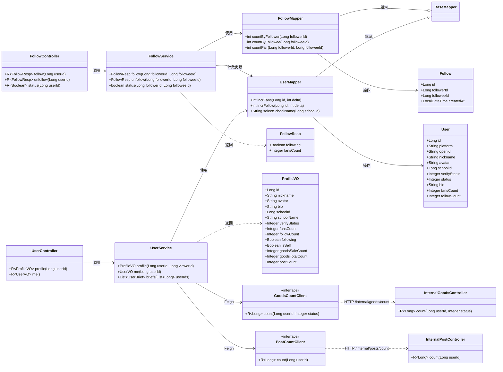
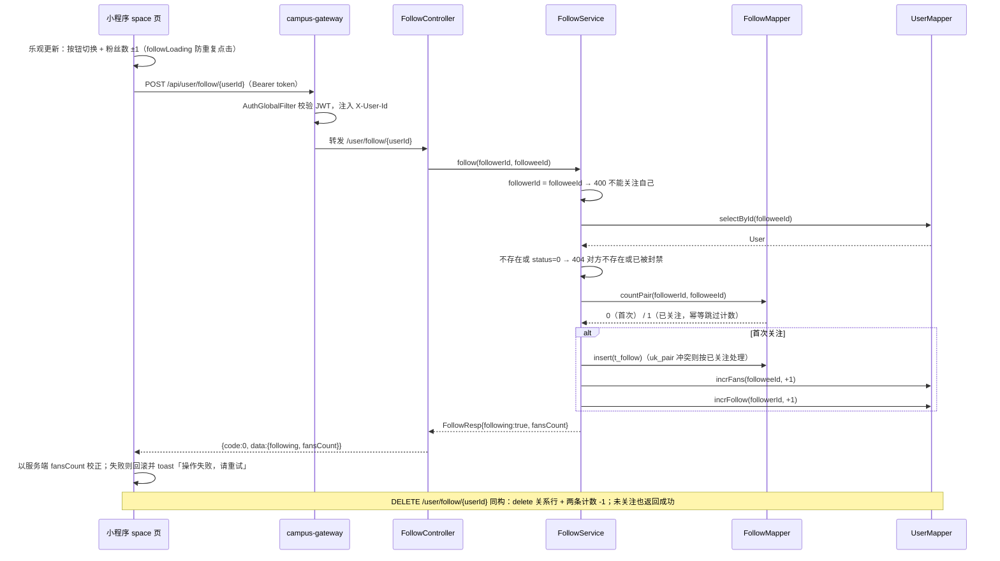
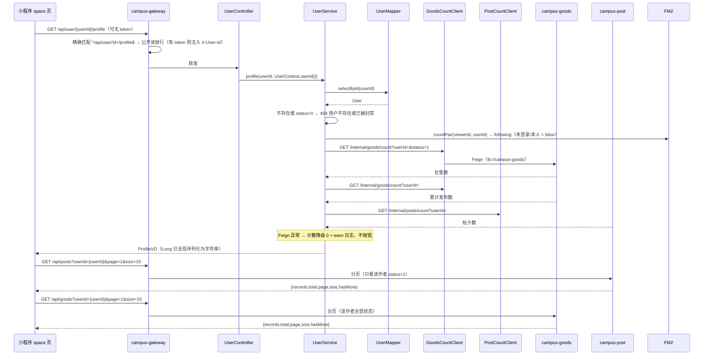
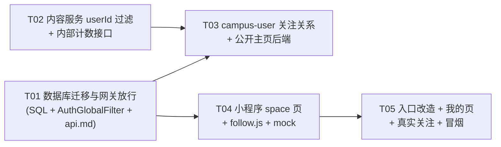

# 系统设计：关注 / 粉丝与个人主页（campus_follow_profile）

> 版本：v1.0 ｜ 作者：架构师 高见远 ｜ 日期：2026-10-25
> 上游输入：`docs/PRD-关注粉丝与个人主页.md`（产品经理 许清楚，v1.0）
> 仓库：F:/校园趣事（微信小程序 + Spring Cloud 微服务，MySQL 库 guizhou_campus_fun）

---

## Part A：系统设计

### 1. 实现方案与框架选型

#### 1.1 核心技术难点与对策

| # | 难点 | 对策 |
|---|------|------|
| 1 | **计数一致性**：关注/取消要同时维护 `t_follow` 关系行与 `t_user` 两行计数器（被关注者 `fans_count`、关注者 `follow_count`），且要幂等 | 单事务内完成「关系 insert/delete + 两条计数 UPDATE」；计数 SQL 用 `greatest(x + delta, 0)` 防负数；`uk_pair(follower_id, followee_id)` 唯一键兜底幂等，重复插入的 `DuplicateKeyException` 捕获后按「已关注」处理，不重复计数。详见 1.4 |
| 2 | **未登录可访问公开主页**：现有网关 `AuthGlobalFilter` 对 `/api/user/**` 一律要求 JWT，而 `GET /user/{userId}/profile` 与 `GET /user/follow/status` 需要匿名可读 | 不改宽泛前缀（防止误开 `/user/me`），用**精确路径匹配**放行：`^/api/user/\d+/profile$`（GET）与 `/api/user/follow/status`（GET 精确相等）。`/user/me` 中 "me" 非数字，不受影响；POST/DELETE 关注操作仍强制登录 |
| 3 | **跨服务聚合**：个人主页需要「闲置在售/累计发布数、帖子数」，数据在 campus-goods / campus-post | campus-user 通过 OpenFeign 调两个新增内部接口 `GET /internal/goods/count`、`GET /internal/posts/count`（`/internal/**` 不经网关，沿用 `UserClient` 同款模式）。调用失败降级为 0 并打 warn 日志，**不允许主页整体 500** |
| 4 | **前端乐观更新与回滚**：关注按钮要点完立即切换，失败回滚 | 抽出 `utils/follow.js` 收敛「保证登录 + 发请求」；各页面自行做乐观更新 / 回滚 / 防重复点击（loading 标志位）。回滚统一 toast「操作失败，请重试」 |
| 5 | **雪花 ID 精度**：19 位 Long 超 JS 安全整数 | 沿用全局 `JacksonConfig`（Long → String 序列化）与「ID 一律字符串透传、不 `Number()`」约定。计数类字段是 `Integer`，保持数字 |

#### 1.2 框架与库选型（**零新增依赖**）

- 后端：Spring Boot 3 + Spring Cloud Gateway + Nacos + MyBatis-Plus + OpenFeign，全部沿用现状。campus-common 已引入 `spring-cloud-starter-openfeign`，campus-user 依赖 campus-common，**无需改任何 pom.xml**；只需给 `UserApplication` 补 `@EnableFeignClients`（对齐 PostApplication 写法）。
- 前端：微信小程序原生（WXML/WXSS/JS），无框架、无新组件库。
- 不引入 Redis 计数：多服务共库现状下 MySQL 行锁 + 唯一键已足够（关注是低频写操作）；与仓库现有 `like_count / comment_count` 计数器风格保持一致。

#### 1.3 为什么关注模块放 campus-user（8102）

1. **数据同域**：`t_follow` 与 `t_user` 同库（`guizhou_campus_fun`），关注关系本质是用户域数据；主页 80% 字段（头像/昵称/学校/认证/计数字段）都来自 `t_user`，放 campus-user 零跨库。
2. **路由零改动**：网关已有 `Path=/api/user/**` → `lb://campus-user`，新增 `/user/follow/**`、`/user/{id}/profile` 自动生效，**不需要改 application.yml 路由、不需要重启网关**（仅需改 AuthGlobalFilter 白名单判断）。
3. **API 家族统一**：与现有 `/user/me`、`/user/verify` 同 controller 家族，前端路径心智一致；`/user/me` 顺便带回关注/粉丝计数，「我的」页零新增请求。
4. **不新建微服务**：关注功能无独立压力模型，新建服务（注册、配置、部署、监控）成本远高于收益；独立互动服务留作 P2+ 演进方向。

#### 1.4 计数事务策略（重点）

```
follow(followerId, followeeId)   @Transactional(rollbackFor = Exception.class)
  1. followerId.equals(followeeId)        → 400 "不能关注自己"
  2. selectById(followeeId)；null 或 status=0 → 404 "对方不存在或已被封禁"
  3. selectOne(follower_id, followee_id)  → 已存在则跳过 4（幂等）
  4. insert t_follow
     update t_user set fans_count   = greatest(fans_count   + 1, 0) where id = followeeId
     update t_user set follow_count = greatest(follow_count + 1, 0) where id = followerId
  5. 返回 {following:true, fansCount: followee.fans_count}

unfollow(...)  同事务：delete t_follow 行 + 两条计数 -1；关系不存在也返回成功（幂等）
```

- **原子性**：关系行与计数器同一本地事务，失败整体回滚，不会出现「有关注关系但计数没加」。
-**防负数**：`greatest(..., 0)`（与 `PostMapper.incrLike` 现有写法一致）。
- **并发幂等**：双重点击/双卡提交由 `uk_pair` 唯一键拦截，捕获 `DuplicateKeyException` 后按已关注处理（MySQL 下失败语句不回滚事务）。
- **已知取舍**：历史数据无对账，计数器与 `COUNT(*)` 可能漂移 → 登记为 P2（R19 对账脚本），本期不做。

---

### 2. 文件清单

#### 后端 · 新建（11）

| 文件 | 说明 |
|------|------|
| `backend/sql/migration-20261025-follow-profile.sql` | 迁移：`t_follow` 表 + `t_user` 计数字段（幂等，日期可按实际执行日调整） |
| `backend/campus-user/src/main/java/com/campus/user/entity/Follow.java` | 关注关系实体 |
| `backend/campus-user/src/main/java/com/campus/user/mapper/FollowMapper.java` | `BaseMapper<Follow>` + 计数查询 |
| `backend/campus-user/src/main/java/com/campus/user/service/FollowService.java` | 关注/取消/状态查询（事务） |
| `backend/campus-user/src/main/java/com/campus/user/controller/FollowController.java` | `/user/follow/**` 三个端点 |
| `backend/campus-user/src/main/java/com/campus/user/dto/FollowResp.java` | 关注操作返回 `{following, fansCount}` |
| `backend/campus-user/src/main/java/com/campus/user/dto/ProfileVO.java` | 公开主页 VO |
| `backend/campus-user/src/main/java/com/campus/user/client/GoodsCountClient.java` | Feign → campus-goods `/internal/goods/count` |
| `backend/campus-user/src/main/java/com/campus/user/client/PostCountClient.java` | Feign → campus-post `/internal/posts/count` |
| `backend/campus-post/src/main/java/com/campus/post/controller/InternalPostController.java` | `GET /internal/posts/count?userId=` |
| `backend/campus-goods/src/main/java/com/campus/goods/controller/InternalGoodsController.java` | `GET /internal/goods/count?userId=&status=` |

#### 后端 · 修改（12）

| 文件 | 改动 |
|------|------|
| `backend/sql/schema.sql` | 补 `t_follow` DDL 与 `t_user` 两列（全新部署一致） |
| `backend/campus-user/src/main/java/com/campus/user/entity/User.java` | `+fansCount / +followCount` |
| `backend/campus-user/src/main/java/com/campus/user/dto/UserVO.java` | `+fansCount / +followCount`（`/user/me` 带回，供「我的」页） |
| `backend/campus-user/src/main/java/com/campus/user/mapper/UserMapper.java` | `+incrFans / +incrFollow`（`@Update`，仿 `PostMapper.incrLike`） |
| `backend/campus-user/src/main/java/com/campus/user/service/UserService.java` | `+profile(userId, viewerId)`；`me()` 补计数字段 |
| `backend/campus-user/src/main/java/com/campus/user/controller/UserController.java` | `+GET /user/{userId}/profile` |
| `backend/campus-user/src/main/java/com/campus/user/UserApplication.java` | `+@EnableFeignClients(basePackages = {"com.campus.common.client", "com.campus.user.client"})` |
| `backend/campus-post/src/main/java/com/campus/post/controller/PostController.java` | `/posts` 增 `userId` 参数 |
| `backend/campus-post/src/main/java/com/campus/post/service/PostService.java` | `+pageByUser(...)`、`+countByUser(...)` |
| `backend/campus-goods/src/main/java/com/campus/goods/controller/GoodsController.java` | `/goods` 增 `userId` 参数 |
| `backend/campus-goods/src/main/java/com/campus/goods/service/GoodsService.java` | `page(...)` 支持 userId 分支、`+countByUser(...)` |
| `backend/campus-gateway/src/main/java/com/campus/gateway/filter/AuthGlobalFilter.java` | 公开读放行：GET `/api/user/{id}/profile`、GET `/api/user/follow/status` |

#### 小程序 · 新建（6）

| 文件 | 说明 |
|------|------|
| `miniprogram/pages/user/space/space.js` | 个人介绍页逻辑 |
| `miniprogram/pages/user/space/space.wxml` | 个人介绍页结构 |
| `miniprogram/pages/user/space/space.json` | `{"navigationBarTitleText":"个人主页","usingComponents":{}}` |
| `miniprogram/pages/user/space/space.wxss` | 页面样式（沿用「我的」页 hero 视觉） |
| `miniprogram/utils/follow.js` | 关注/取消共享逻辑（保证登录 + 发请求） |
| `miniprogram/utils/mock.js` → 见下方「修改」列 | mock 分支 |

#### 小程序 · 修改（10）

| 文件 | 改动 |
|------|------|
| `miniprogram/app.json` | `pages` 注册 `pages/user/space`（插在 `pages/user/profile` 之后） |
| `miniprogram/utils/mock.js` | seed 增 `users`（9001–9006 资料）与 `follows`（初始关系）；route 增 profile/follow 4 条分支；`meVO()` 补计数字；`queryPosts/queryGoods` 支持 `userId` |
| `miniprogram/pages/index/index.js` | feed/hotPost 映射补 `authorId`；新增 `goUserSpace`；重写 `onFollow`（真实关注）；`data` 增 `followedAuthors` |
| `miniprogram/pages/index/index.wxml` | 作者行头像/昵称包 `catchtap="goUserSpace"`；`+ 关注` 按钮接 `onFollow` |
| `miniprogram/pages/goods/detail.js` | `load()` 后拉关注状态；新增 `goUserSpace`；重写 `onFollow`（乐观+防重） |
| `miniprogram/pages/goods/detail.wxml` | 卖家卡头像/信息包 `catchtap="goUserSpace"`；关注按钮文案绑定 |
| `miniprogram/pages/post/detail.js` | 新增 `goUserSpace` |
| `miniprogram/pages/post/detail.wxml` | 作者栏头像/昵称包 `catchtap="goUserSpace"` |
| `miniprogram/pages/user/index.js` | `loadMe()` 存 `fansCount/followCount`；新增 `goMyFollows` |
| `miniprogram/pages/user/index.wxml` | 社交互动区「浏览足迹」替换为「我的关注」 |
| `scripts/api-smoke-test.js` | 补 follow/profile/userId 过滤冒烟段 |
| `docs/api.md` | 补新接口契约（关注 3 + 主页 1 + 列表参数 2 + 内部 2） |

---

### 3. 数据结构与接口（classDiagram）



---

### 4. 程序调用流（sequenceDiagram）

#### 4.1 关注 / 取消关注（含幂等、自关注、封禁校验）



#### 4.2 个人主页加载（未登录可访问 + 跨服务计数聚合）



---

### 5. 数据库设计（移交 DBA / 后端）

#### 5.1 `t_follow`（迁移文件 `backend/sql/migration-20261025-follow-profile.sql`）

```sql
CREATE TABLE IF NOT EXISTS t_follow (
  id          BIGINT      NOT NULL PRIMARY KEY COMMENT '雪花ID',
  follower_id BIGINT      NOT NULL COMMENT '关注者（谁发起关注）',
  followee_id BIGINT      NOT NULL COMMENT '被关注者',
  created_at  DATETIME    DEFAULT CURRENT_TIMESTAMP COMMENT '关注时间',
  UNIQUE KEY uk_pair (follower_id, followee_id),
  KEY idx_followee (followee_id, created_at),
  KEY idx_follower (follower_id, created_at)
) COMMENT '关注关系';
```

- `uk_pair`：幂等 + 防重复关注；`idx_followee`：粉丝列表/粉丝计数；`idx_follower`：关注列表/关注计数。
- `id` 由 MyBatis-Plus `ASSIGN_ID` 生成（与全局雪花策略一致）。

#### 5.2 `t_user` 计数字段（幂等 ALTER，仿 `migration-20261024-school-district.sql` 的 information_schema 判断写法）

```sql
ALTER TABLE t_user ADD COLUMN fans_count   INT NOT NULL DEFAULT 0 COMMENT '粉丝数' AFTER bio;
ALTER TABLE t_user ADD COLUMN follow_count INT NOT NULL DEFAULT 0 COMMENT '关注数' AFTER fans_count;
```

`backend/sql/schema.sql` 同步补丁（全新部署与迁移结果一致）。

---

### 6. API 设计（移交前端 / 测试）

统一约定：网关前缀 `/api`；响应 `{code,msg,data}`，`code=0` 成功；401 未登录 / 400 参数或业务校验 / 403 无权限 / 404 不存在。**所有 id 为字符串**（雪花 ID 全局序列化），计数为数字。

#### 6.1 关注（campus-user，除 status 外均需登录）

| 方法 | 路径 | 登录 | 说明 |
|------|------|------|------|
| POST | `/api/user/follow/{userId}` | 必须 | 关注。幂等：已关注直接成功不重复计数。返回 `{following:true, fansCount}` |
| DELETE | `/api/user/follow/{userId}` | 必须 | 取消关注。未关注也返回成功。返回 `{following:false, fansCount}` |
| GET | `/api/user/follow/status?userId=` | 否 | 当前用户对目标的关注状态。**未登录返回 `{following:false}`，不报 401** |

错误码：

| 场景 | code | msg |
|------|------|-----|
| 关注自己 | 400 | 不能关注自己 |
| 目标不存在 / 被封禁（status=0） | 404 | 对方不存在或已被封禁 |
| 未登录调 POST/DELETE | 401 | 请先登录 |

#### 6.2 公开主页

| 方法 | 路径 | 登录 | 说明 |
|------|------|------|------|
| GET | `/api/user/{userId}/profile` | 否（🔓） | 他人公开资料 + 统计。被封禁/不存在返回 404「用户不存在或已被封禁」 |

响应 `data`（ProfileVO）：

```json
{
  "id": "9002",                 // 字符串
  "nickname": "陈屿",
  "avatar": "http://127.0.0.1:8888/uploads/...",
  "bio": "计算机学院，出闲置回消息很快",
  "schoolId": "1005",
  "schoolName": "浙江大学",
  "verifyStatus": 2,            // 0未认证 1审核中 2已认证 3驳回
  "fansCount": 12,              // 粉丝数（计数器）
  "followCount": 5,             // 关注数（计数器）
  "following": false,           // 当前登录用户是否已关注；未登录/本人 = false
  "isSelf": false,              // 是否本人主页
  "goodsSaleCount": 2,          // 闲置在售数（Feign 聚合）
  "goodsTotalCount": 4,         // 闲置累计发布数（Feign 聚合）
  "postCount": 3                // 帖子数（Feign 聚合）
}
```

- **不返回** `phone / studentNo / realName / verifyImg` 等敏感字段。
- `verifyStatus` 直接透出整型，前端徽章规则：`===2` → 「✓ 已认证」，否则「未认证」。

#### 6.3 列表按作者过滤（P0，改现有接口）

| 方法 | 路径 | 说明 |
|------|------|------|
| GET | `/api/posts?userId=&page&size` | 新增可选 `userId`。**传 userId 时忽略 school/city 范围**，只返回该作者 `status=1` 帖子，按时间倒序；分页结构 `{records,total,page,size,hasMore}` 不变 |
| GET | `/api/goods?userId=&page&size` | 新增可选 `userId`。传 userId 时**返回该作者全部状态**（0下架/1在售/2已售出，前端渲染状态标签），忽略学校范围与默认 `status=1` 过滤；排序/分页结构不变 |

不传 `userId` 时行为与现状**完全一致**（回归重点）。

#### 6.4 「我的」数据（零新端点）

`GET /api/user/me` 的 `UserVO` 新增 `fansCount / followCount` 两个字段（Integer），「我的」页直接读，不新增请求。

#### 6.5 内部接口（不经网关，仅服务间 Feign）

| 方法 | 路径 | 归属 | 说明 |
|------|------|------|------|
| GET | `/internal/goods/count?userId=&status=` | campus-goods | 计数；`status` 可选，不传=全部（已物理删除的不计） |
| GET | `/internal/posts/count?userId=` | campus-post | 该作者 `status=1` 帖子数 |

#### 6.6 P1（本期不实现，登记在案）

`GET /api/user/me/following?page&size`、`GET /api/user/me/fans?page&size`（关注/粉丝列表页 R10）；消息中心 `followers` 汇总（R12）。原因：PRD 定级 P1，且本次任务分解受「≤5 任务」硬上限约束。

---

### 7. 小程序端设计

#### 7.1 新页面 `pages/user/space`（个人介绍页）

四件套：`space.js / space.wxml / space.json / space.wxss`；json 显式 `"usingComponents": {}`；`app.json` 的 `pages` 插在 `pages/user/profile` 之后。

**data 模型**：

```js
{
  userId: '',          // onLoad(options.id)，字符串透传
  profile: null,       // ProfileVO（avatar 过 img.resolve）
  tab: 'post',         // post | goods，默认帖子
  posts: [], goods: [],
  postsLoading: true, goodsLoading: true,
  postsDone: false, goodsDone: false,   // 触底分页
  postsPage: 1, goodsPage: 1,
  followLoading: false,
  notFound: false
}
```

**关键函数**：

| 函数 | 行为 |
|------|------|
| `onLoad(options)` | 存 `userId`；`loadProfile()`；`loadPosts(true)` |
| `loadProfile()` | `GET /user/{userId}/profile`（silent）；404 → `notFound=true`；头像 `resolve()`；按 `isSelf` 决定按钮区 |
| `loadPosts(refresh)` / `loadGoods(refresh)` | `GET /posts` / `GET/goods` 带 `userId`，size=10；下拉/触底翻页；映射字段对齐首页 feed（timeText、imageList=resolveList、priceText、statusText） |
| `switchTab(e)` | 切 Tab，首次切到闲置才懒加载 |
| `onFollowTap()` | 见下方乐观更新模板 |
| `goUserSpace` 类跳转 | `goPostDetail / goGoodsDetail` → 对应详情页 |
| `goEditProfile()` | `isSelf` 时显示「编辑资料」→ `navigateTo /pages/user/profile` |
| `onPullDownRefresh / onReachBottom` | 刷新 / 加载更多 |

**乐观更新模板（onFollowTap，三个页面共用同一范式）**：

```js
onFollowTap: function () {
  if (this.data.followLoading) return                       // 防重复点击
  var self = this
  var prev = { following: this.data.following, fansCount: this.data.profile.fansCount }
  var next = !prev.following
  this.setData({ followLoading: true, following: next,
    'profile.fansCount': Math.max(0, (prev.fansCount || 0) + (next ? 1 : -1)) })
  followMod.toggle(this.userId, prev.following).then(function (res) {
    self.setData({ followLoading: false, following: res.following, 'profile.fansCount': res.fansCount })
    toast(next ? '已关注' : '已取消关注')
  }).catch(function () {
    self.setData({ followLoading: false, following: prev.following, 'profile.fansCount': prev.fansCount })
    toast('操作失败，请重试')                                  // 回滚
  })
}
```

**WXML 骨架**：

```wxml
<view class="page">
  <!-- 头部卡：绿色渐变，同「我的」页 hero -->
  <view class="hero">
    <view class="user-row">
      <image class="avatar-img" src="{{profile.avatar}}" mode="aspectFill"/>
      <view class="user-info">
        <view class="user-name-row">
          <text class="user-name">{{profile.nickname}}</text>
          <view class="verify-pill {{profile.verifyStatus === 2 ? 'ok' : ''}}">
            <text>{{profile.verifyStatus === 2 ? '✓ 已认证' : '未认证'}}</text>
          </view>
        </view>
        <view class="user-school">🎓 {{profile.schoolName || '同校同学'}}</view>
        <view class="user-bio" wx:if="{{profile.bio}}">{{profile.bio}}</view>
      </view>
      <view class="follow-btn {{following ? 'on' : ''}}" wx:if="{{!profile.isSelf}}" catchtap="onFollowTap">
        {{following ? '已关注' : '+ 关注'}}
      </view>
      <view class="follow-btn ghost" wx:else catchtap="goEditProfile">编辑资料</view>
    </view>
    <view class="stat-bar">
      <view class="stat"><view class="stat-num">{{profile.followCount}}</view><view class="stat-label">关注</view></view>
      <view class="stat"><view class="stat-num">{{profile.fansCount}}</view><view class="stat-label">粉丝</view></view>
    </view>
  </view>
  <!-- Tab：帖子 / 闲置 -->
  <view class="tabs">
    <view class="tab {{tab === 'post' ? 'active' : ''}}" data-tab="post" bindtap="switchTab">帖子</view>
    <view class="tab {{tab === 'goods' ? 'active' : ''}}" data-tab="goods" bindtap="switchTab">闲置</view>
  </view>
  <!-- 列表 + 空态「还没有发布内容」 -->
</view>
```

#### 7.2 关注按钮组件化评估：**不做 `components/follow-btn`，做 `utils/follow.js`**

| 方案 | 结论 |
|------|------|
| `components/follow-btn` 自定义组件 | ❌ 不值得。三处视觉形态完全不同（信息流小 chip / 卖家卡按钮 / 主页主按钮），状态来源各异（列表无初始关注态、详情/主页有），抽成组件要设计 properties + 事件回拢 + 三套 slot，复杂度高于收益；仓库唯一自定义组件 `scope-sheet` 是有独立交互逻辑的弹层，不构成反例 |
| `utils/follow.js` 共享逻辑 | ✅ 采用。收敛「`auth.ensureLogin()` + POST/DELETE `/user/follow/{id}`」三行核心逻辑；乐观更新/回滚/防重由各页面 20 行内联处理，直观可改 |

```js
// miniprogram/utils/follow.js
var http = require('./request')
var auth = require('./auth')

/**
 * 关注 / 取消关注。页面自行做乐观更新与回滚。
 * @param {String} userId 对方 id（字符串透传）
 * @param {Boolean} following 当前是否已关注（true → 取消关注）
 * @returns {Promise<{following:Boolean, fansCount:Number}>}
 */
function toggle(userId, following) {
  return auth.ensureLogin().then(function () {
    var url = '/user/follow/' + userId
    return following ? http.del(url) : http.post(url)
  })
}
module.exports = { toggle: toggle }
```

#### 7.3 跳转入口改造点（精确到文件与函数）

| 入口 | 文件 | 函数 / 位置 | 改动 |
|------|------|-------------|------|
| 首页信息流 · 帖子卡 | `pages/index/index.js` | `loadData()` 的 posts 映射 | 映射补 `authorId: p.userId` |
| 首页信息流 · 闲置卡 | `pages/index/index.js` | `loadData()` 的 goods 映射 | 映射补 `authorId: g.userId` |
| 首页最热帖卡 | `pages/index/index.js` | `loadData()` 的 hotPost 映射 | 补 `authorId: hot.userId` |
| 首页作者行跳转 | `pages/index/index.wxml` | `.feed-avatar` 与 `.feed-user-info` | 包 `catchtap="goUserSpace" data-id="{{item.authorId}}"`（**catchtap 阻止冒泡到卡片整体详情跳转**）；`.hot-user` 同样处理 |
| 首页「+ 关注」 | `pages/index/index.js` + `index.wxml` | `onFollow()`（占位 toast 重写） | 真实关注/取消；`data` 增 `followedAuthors`（`{ [id]: {following, loading} }`），按钮文案 `{{followedAuthors[item.authorId].following ? '已关注' : '+ 关注'}}` |
| 闲置详情 · 卖家卡 | `pages/goods/detail.js` | `load()` 成功回调 | `!isOwner && g.userId` 时静默拉 `GET /user/follow/status?userId=` 初始化 `following`；新增 `goUserSpace()` |
| 闲置详情 · 卖家卡 | `pages/goods/detail.wxml` | `.seller-avatar-wrap` 与 `.seller-info` | 包 `catchtap="goUserSpace" data-id="{{goods.userId}}"` |
| 闲置详情 · 「关注」 | `pages/goods/detail.js` + `detail.wxml` | `onFollow()`（占位 toast 重写） | 真实关注/取消，乐观更新 + `followLoading` 防重 |
| 帖子详情 · 作者栏 | `pages/post/detail.js` + `detail.wxml` | 新增 `goUserSpace()`；`.ab-avatar` 与作者名 `view` | 包 `catchtap="goUserSpace" data-id="{{post.userId}}"`；右上「同校」按钮**保持静态标签不变**（Open Q1 默认值） |

#### 7.4 「我的」页改造（`pages/user/index`）

- `index.js` `loadMe()`：`/user/me` 响应新增 `fansCount/followCount` → `setData`；新增 `goMyFollows()` → `navigateTo /pages/user/space?id={{user.id}}`（P0 跳自己主页，主页 `isSelf` 显示「编辑资料」；P1 换 `pages/user/follows` 列表页）。
- `index.wxml`：社交互动区 grid2 的「浏览足迹」占位项**替换**为「我的关注」：

```wxml
<view class="g2-item" bindtap="goMyFollows">
  <view class="g2-icon gi-pink">👥</view>
  <view class="g2-main">
    <view class="g2-title">我的关注</view>
    <view class="g2-sub">{{followCount}} 关注 · {{fansCount}} 粉丝</view>
  </view>
</view>
```

- 统计条写死数字（38/12/6/156）**不动**（R11 真实化属 P1，见 Open Q8）。

#### 7.5 mock 模式（`utils/mock.js`，T04 内完成）

- `seed()` 增 `users`：9001–9006 六人资料（id/nickname/avatar:''/schoolId/verifyStatus:2/bio/status:1；姓名取现有种子：林小满、陈屿、周小舟、苏念、阿泽、李知夏）；`follows`：初始 3 条关系（如 9001→9002、9003→9001、9005→9001）。
- `route()` 在 `s[0] === 'user'` 分支内新增：
  - `GET /user/{id}/profile`（公开；用户缺失或 status=0 → 404；`following` 按登录态与 `db.follows` 计算；计数从 `db.follows/db.goods/db.posts` 实时统计）
  - `POST /user/follow/{id}`、`DELETE /user/follow/{id}`（未登录 401；自己 → 400；维护 `db.follows`）
  - `GET /user/follow/status?userId=`（未登录 `{following:false}`）
- `meVO()` 补 `fansCount/followCount`（由 `db.follows` 计算）。
- `queryPosts/queryGoods` 支持 `q.userId` 过滤。
- `scripts/mock-selftest.js` 补对应断言（关注幂等、计数联动、未登录状态为 false、主页 404）。

---

### 8. 待明确事项（需主理人拍板；括号内为建议默认值，工程师按默认值执行）

| # | 问题 | 建议默认值 |
|---|------|-----------|
| 1 | 帖子详情「同校」按钮是否保持静态标签？ | **保持静态**（关注统一在个人主页完成；如需一键关注需补设计稿） |
| 2 | 首页「+关注」/闲置详情「关注」是否纳入 P0？ | **纳入**（R9 并入 T05；接口就绪、改动小、设计稿已有入口） |
| 3 | 「我的关注」入口位置？ | **替换社交互动区「浏览足迹」占位项**（grid2 保持 4 项布局，副文案「N 关注 · N 粉丝」），待 UI 确认 |
| 4 | 未登录访问他人主页？ | **允许**（🔓 公开，关注时引导登录） |
| 5 | 被封禁用户主页是否展示？ | **404 不展示**（与关注接口一致） |
| 6 | 个人主页默认 Tab？ | **「帖子」**；「赞与收藏」Tab 不做（P2 R18，需跨服务聚合） |
| 7 | mock 模式是否 P0 同步支持？ | **同步支持**（T04 含 mock，无后端可演示验收） |
| 8 | 「我的」页统计条写死数字是否本次真实化？ | **不纳入**（R11 属 P1，涉及已卖出/动态/赞与收藏跨服务统计） |

**架构师补充的两条范围声明**（同样需要主理人确认）：

- **R10 关注/粉丝列表页（P1）本期不实现**：受「≤5 任务」硬上限与 PRD P1 定级约束，P0 阶段「我的关注」入口先跳自己个人主页；后端 `/user/me/following`、`/user/me/fans` 留待下一迭代。
- **R12 消息中心 followers 计数（P1）不接**：`MessageCenterVO.summary.followers` 维持硬编码 0，避免 campus-message → campus-user 新增一次跨服务改造挤占 P0 带宽。

---

## Part B：任务分解

### 9. 依赖包清单

**预计零新增**。理由：

- 后端：Feign、MyBatis-Plus、validation、jjwt 均已由 `campus-common` 传递依赖提供；campus-user 只需加一个注解（`@EnableFeignClients`）。
- 前端：原生小程序，无包管理。
- 若后续要跑 `scripts/api-smoke-test.js`，也只需 Node 内置模块（现状已如此）。

### 10. 任务列表（按实现顺序，共 5 个）

---

#### T01 数据库迁移与网关放行（基础设施）

- **Source Files**：
  - `backend/sql/migration-20261025-follow-profile.sql`（新建）
  - `backend/sql/schema.sql`（修改：补 `t_follow` DDL + `t_user` 两列）
  - `backend/campus-gateway/src/main/java/com/campus/gateway/filter/AuthGlobalFilter.java`（修改）
  - `docs/api.md`（修改：补 6.1–6.5 全部接口契约）
- **Dependencies**：无
- **Priority**：P0
- **内容**：
  1. 迁移 SQL 按 5.1/5.2 编写；`t_user` 两列用 `information_schema` 判断做幂等 ALTER（仿 `migration-20261024-school-district.sql`）；文件头注释写清执行命令。
  2. `schema.sql` 同步内联补丁，保证全新库与迁移结果一致。
  3. `AuthGlobalFilter` 新增两个公开读条件（**精确匹配，不放宽前缀**）：
     ```java
     private static final Pattern PUBLIC_PROFILE = Pattern.compile("^/api/user/\\d+/profile$");
     // filter() 内：
     boolean publicProfile = "GET".equals(method) && PUBLIC_PROFILE.matcher(path).matches();
     boolean publicFollowStatus = "GET".equals(method) && "/api/user/follow/status".equals(path);
     boolean publicRead = publicProfile || publicFollowStatus || (原 PUBLIC_READ_PREFIX 逻辑);
     ```
  4. `docs/api.md` 补：关注 3 接口、主页 1 接口、`/posts` `/goods` 的 `userId` 参数、2 个内部接口、`/user/me` 新字段。
- **验收标准**：
  1. 迁移脚本连续执行两次不报错；`SHOW CREATE TABLE t_follow` 含 `uk_pair / idx_followee / idx_follower`；`DESC t_user` 含 `fans_count / follow_count`（INT NOT NULL DEFAULT 0）。
  2. 不带 token：`GET /api/user/9002/profile` 不返回 401；`GET /api/user/follow/status?userId=9002` 不返回 401；`GET /api/user/me` 仍 401；`POST /api/user/follow/9002` 仍 401。
  3. `mvn -pl backend/campus-gateway -am compile` 通过（注意父 POM `-parameters` 不动）。
  4. 网关路由 application.yml **零改动**（`/api/user/**` 已覆盖）。

---

#### T02 内容服务：userId 过滤与内部计数接口

- **Source Files**：
  - `backend/campus-post/src/main/java/com/campus/post/controller/PostController.java`（修改）
  - `backend/campus-post/src/main/java/com/campus/post/service/PostService.java`（修改）
  - `backend/campus-post/src/main/java/com/campus/post/controller/InternalPostController.java`（新建）
  - `backend/campus-goods/src/main/java/com/campus/goods/controller/GoodsController.java`（修改）
  - `backend/campus-goods/src/main/java/com/campus/goods/service/GoodsService.java`（修改）
  - `backend/campus-goods/src/main/java/com/campus/goods/controller/InternalGoodsController.java`（新建）
- **Dependencies**：无（可与 T01 并行）
- **Priority**：P0
- **内容**：
  1. `PostController.page()` 增 `@RequestParam(required=false) Long userId`：非空时直接走 `postService.pageByUser(userId, page, size, UserContext.userId())`，**跳过 school/city 范围逻辑**。
  2. `PostService` 增 `pageByUser`（`eq(userId).eq(status,1).orderByDesc(createdAt)`，复用现有 `decorate/channelMap/likedIds`）与 `countByUser`（`selectCount`）。
  3. `GoodsController.page()` 增 `userId`：非空时**不加 `status=1`、不加学校范围**，返回该作者全部状态商品。
  4. `GoodsService` 增 `countByUser(userId, status)`（status 可空）。
  5. 两个 `Internal*Controller` 按 6.5 实现，返回 `R<Long>`；`/internal/**` 不经网关（现状即无路由）。
- **验收标准**：
  1. `GET /api/posts?userId=9002&page=1&size=10` 返回全部 `userId=9002` 的 `status=1` 帖子，分页结构 `{records,total,page,size,hasMore}` 不变。
  2. `GET /api/goods?userId=9002` 返回该作者含 `status=0/2` 的全部商品；不带 `userId` 的 `/posts`、`/goods` 行为与改造前**逐字段一致**（回归）。
  3. `curl campus-goods:8103/internal/goods/count?userId=9002` 与 `?userId=9002&status=1`、`campus-post:8105/internal/posts/count?userId=9002` 返回正确数字。
  4. 编译通过；`/internal/**` 从网关访问返回 404（无路由）。

---

#### T03 campus-user：关注关系 + 公开主页后端

- **Source Files**：
  - `backend/campus-user/src/main/java/com/campus/user/entity/Follow.java`（新建）
  - `backend/campus-user/src/main/java/com/campus/user/mapper/FollowMapper.java`（新建）
  - `backend/campus-user/src/main/java/com/campus/user/service/FollowService.java`（新建）
  - `backend/campus-user/src/main/java/com/campus/user/controller/FollowController.java`（新建）
  - `backend/campus-user/src/main/java/com/campus/user/dto/FollowResp.java`（新建）
  - `backend/campus-user/src/main/java/com/campus/user/dto/ProfileVO.java`（新建）
  - `backend/campus-user/src/main/java/com/campus/user/client/GoodsCountClient.java`（新建）
  - `backend/campus-user/src/main/java/com/campus/user/client/PostCountClient.java`（新建）
  - `backend/campus-user/src/main/java/com/campus/user/entity/User.java`（修改：`+fansCount/+followCount`）
  - `backend/campus-user/src/main/java/com/campus/user/dto/UserVO.java`（修改：`+fansCount/+followCount`）
  - `backend/campus-user/src/main/java/com/campus/user/mapper/UserMapper.java`（修改：`+incrFans/+incrFollow`）
  - `backend/campus-user/src/main/java/com/campus/user/service/UserService.java`（修改：`+profile()`；`me()` 补计数）
  - `backend/campus-user/src/main/java/com/campus/user/controller/UserController.java`（修改：`+GET /{userId}/profile`）
  - `backend/campus-user/src/main/java/com/campus/user/UserApplication.java`（修改：`@EnableFeignClients`）
- **Dependencies**：T01（表与网关放行）、T02（内部计数接口）
- **Priority**：P0
- **内容**：按 1.4 / 6.1 / 6.2 实现。要点：
  1. `Follow` 实体 `@TableName("t_follow")`、`@TableId(type = IdType.ASSIGN_ID)`；`FollowMapper` 补 `countByFollower / countByFollowee / countPair`（`@Select`）。
  2. `UserMapper` 补 `@Update("update t_user set fans_count = greatest(fans_count + #{delta}, 0) where id = #{id}")` 与 `follow_count` 版本。
  3. `FollowService.follow/unfollow` 按 1.4 事务模板；insert 包 try/catch `DuplicateKeyException` → 按已关注处理。
  4. `UserService.profile(userId, viewerId)`：404 规则；`following = viewerId != null && !viewerId.equals(userId) && countPair > 0`；`isSelf = viewerId != null && viewerId.equals(userId)`；学校名走现有 `selectSchoolName`；三个计数走 Feign，**try/catch 降级 0 + log.warn**。
  5. `FollowController`：`@RequestMapping("/user/follow")`；`status` 用 `UserContext.userId()`（可空，不抛 401）；POST/DELETE 用 `requireUserId()`。
  6. `UserApplication` 加 `@EnableFeignClients(basePackages = {"com.campus.common.client", "com.campus.user.client"})`。
- **验收标准**：
  1. 9001 关注 9002 → `{following:true, fansCount:N}`；`t_follow` 增行；`t_user` 9002 `fans_count=N`、9001 `follow_count=M`；**重复 POST 计数不涨**。
  2. 关注自己 → 400；关注不存在/封禁 id → 404；DELETE 后计数 -1；未关注时 DELETE 返回成功。
  3. `GET /user/follow/status?userId=9002` 登录/未登录分别返回真实值 / `false`。
  4. `GET /user/9002/profile` 未登录 → code 0 且字段齐全、**无 phone/studentNo/realName**；带 9001 token 时 `following` 真实、访问 9001 自己时 `isSelf=true`；`status=0` 用户 → 404。
  5. `/user/me` 新增 `fansCount/followCount`；profile 的三个计数与 `/internal` 接口一致；**停掉 campus-goods 后 profile 仍返回 200（计数 0）**。
  6. JSON 中所有 id 为字符串，计数为数字。

---

#### T04 小程序：个人主页页面 + 关注共享逻辑 + mock 数据

- **Source Files**：
  - `miniprogram/pages/user/space/space.js`（新建）
  - `miniprogram/pages/user/space/space.wxml`（新建）
  - `miniprogram/pages/user/space/space.json`（新建）
  - `miniprogram/pages/user/space/space.wxss`（新建）
  - `miniprogram/utils/follow.js`（新建）
  - `miniprogram/app.json`（修改：注册 `pages/user/space`）
  - `miniprogram/utils/mock.js`（修改：按 7.5）
  - `scripts/mock-selftest.js`（修改：补关注/主页断言）
- **Dependencies**：T01（接口契约以 `docs/api.md` 为准；可先用 mock 开发自测，联调依赖 T03 上线）
- **Priority**：P0
- **内容**：按 7.1 / 7.2 / 7.5 实现。
- **验收标准**：
  1. `node scripts/check-miniprogram.js` 通过（四件套齐全、json 显式 `usingComponents`、调用 `Page()`、wxml 非空）。
  2. `USE_MOCK=true` 全流程：他人主页（头像/昵称/认证徽章/学校/bio/关注数/粉丝数）→ Tab 切换 → 空态「还没有发布内容」；未登录点关注 → 引导登录 → 关注成功（粉丝 +1、按钮「已关注」）→ 再点取消（计数 -1、toast「已取消关注」）。
  4. 浏览自己主页 → 显示「编辑资料」（无关注按钮）→ 跳 `/pages/user/profile`。
  5. 乐观回滚：mock 造错/断网 → 按钮与计数回滚 + toast「操作失败，请重试」；`followLoading` 期间重复点击无效。
  6. `node scripts/mock-selftest.js` 全绿（含新增断言）。
  7. 19 位雪花 id 全程字符串透传，无 `Number()` 调用。

---

#### T05 三处跳转入口 + 「我的」页 + 真实关注按钮 + 冒烟自检

- **Source Files**：
  - `miniprogram/pages/index/index.js`（修改）
  - `miniprogram/pages/index/index.wxml`（修改）
  - `miniprogram/pages/goods/detail.js`（修改）
  - `miniprogram/pages/goods/detail.wxml`（修改）
  - `miniprogram/pages/post/detail.js`（修改）
  - `miniprogram/pages/post/detail.wxml`（修改）
  - `miniprogram/pages/user/index.js`（修改）
  - `miniprogram/pages/user/index.wxml`（修改）
  - `scripts/api-smoke-test.js`（修改：补 follow/profile/userId 过滤冒烟段）
- **Dependencies**：T04（跳转目标页面与 `utils/follow.js`）
- **Priority**：P0
- **内容**：按 7.3 / 7.4 实现。冒烟段新增：未登录 `GET /user/9002/profile`、登录后 `GET /user/follow/status`、`POST/DELETE /user/follow/9002`、`/posts?userId=9002`、`/goods?userId=9002`。
- **验收标准**：
  1. 首页/闲置详情/帖子详情三处：点头像或昵称 → `/pages/user/space?id={userId}`；点卡片其余区域仍进原详情页（**catchtap 冒泡阻断验证**）。
  2. 首页「+ 关注」与闲置详情「关注」真实切换（含防重复点击）；刷新后列表态按 `followedAuthors` 展示（无批量状态接口，允许不持久化，需在代码注释说明）。
  3. 帖子详情「同校」按钮保持静态。
  4. 「我的」页显示「N 关注 · N 粉丝」；「我的关注」入口跳自己 space 页。
  5. `node scripts/api-smoke-test.js` 全绿；`node scripts/check-miniprogram.js` 仍通过。

---

### 11. 共享知识 / 跨文件约定

```
- 统一响应 {code, msg, data}，code=0 成功；分页 {records,total,page,size,hasMore}
- 错误码：400 参数/业务校验（如「不能关注自己」）；401 未登录；403 无权限；404 资源不存在
  （用户不存在/被封禁的主页与关注目标统一 404）
- 关注类接口统一返回 FollowResp {following:Boolean, fansCount:Integer}
- DTO 命名：Req=入参；VO=出参（UserVO/ProfileVO）；Brief=跨服务摘要（既有约定）
- Long/long 全局序列化为字符串（JacksonConfig），前端一律字符串透传，禁止 Number()；
  计数字段 Integer 保持数字
- 事务：@Transactional(rollbackFor = Exception.class)；计数 UPDATE 用 greatest(x+delta, 0) 防负数
- Feign：/internal/** 不经过网关；campus-user 新增 client 放 com.campus.user.client，
  UserApplication 已加 @EnableFeignClients；Feign 失败降级不允许打崩主流程
- 网关放行只用精确路径匹配（正则/全等），禁止把 /api/user 加入宽泛公开前缀（会误开 /user/me）
- 前端：请求一律走 utils/request.js；图片走 utils/img.js#resolve()/resolveList()；
  登录态走 utils/auth.js#ensureLogin()；关注逻辑走 utils/follow.js
- 新页面必须四件套 .js/.wxml/.json/.wxss，.json 显式 "usingComponents": {}
- mock 数据只加在 utils/mock.js（seed.users/seed.follows + route 分支 + meVO），断言加 scripts/mock-selftest.js
- 冒烟测试扩展只改 scripts/api-smoke-test.js，公开接口段放 [1]，登录后接口段放 [3]
- 迁移 SQL 命名 migration-YYYYMMDD-<主题>.sql，放 backend/sql/，必须幂等
- 本次不新增任何第三方依赖；网关路由 application.yml 零改动
```

### 12. 任务依赖图



- T01/T02 可并行；T04 依据 T01 的接口契约（docs/api.md）+ mock 先行开发，联调等 T03；T05 最后集成。

---

### 13. 本次明确不做（P1/P2  backlog）

| 项 | 归属 | 原因 |
|----|------|------|
| R10 关注/粉丝列表页 `pages/user/follows` + `/user/me/following` `/user/me/fans` | P1 | 任务数硬上限 5 + PRD 定级 P1 |
| R11「我的」页统计条真实化（已卖出/动态/赞与收藏） | P1 | 跨服务聚合，工作量集中 |
| R12 消息中心 followers 真实计数 | P1 | 需 campus-message → campus-user 改造 |
| R13 主页「编辑资料」之外的资料编辑增强 | P1 | 已有 `/pages/user/profile` 承接 |
| R15 互相关注/特别关注标识 | P2 | 关系可视化增强 |
| R16 新粉丝通知推送 | P2 | 需接消息中心通知流 |
| R17 拉黑/屏蔽 | P2 | 关系反向控制 |
| R18 主页「获赞与收藏」Tab | P2 | 跨 goods/post/wall 聚合，成本高 |
| R19 计数对账校准脚本 | P2 | 计数器与 COUNT 漂移修复 |
